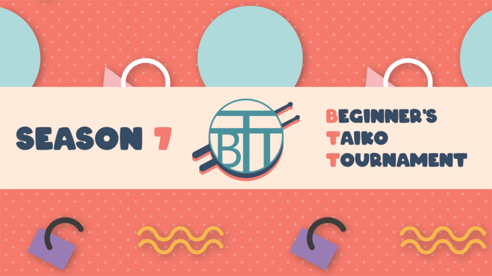

---
tags:
  - BTT
  - BTT7
---

# Beginners' Taiko Tournament Season 7

The **Beginners' Taiko Tournament Season 7** (***BTT7***) was a worldwide double-elimination 1v1 osu!taiko tournament hosted by ::{ flag=NL }:: [TaikoMom](https://osu.ppy.sh/users/9086438). Only players ranked #10,000 and above can participate. It was the seventh instalment of the Beginners' Taiko Tournament.

## Tournament schedule

| Event | Timestamp |
| --: | :-- |
| Registration phase | 2022-07-10/2022-05-01 |
| Qualifiers mappool showcase | 2022-05-01 (16:00 UTC) |
| Qualifiers | 2022-05-06/2022-05-08 |
| Round of 64 | 2022-05-13/2022-05-15 |
| Round of 32 | 2022-05-20/2022-05-22 |
| Round of 16 | 2022-05-28/2022-05-29 |
| Quarterfinals | 2022-06-04/2022-06-05 |
| Semifinals | 2022-06-11/2022-06-12 |
| Finals | 2022-06-18/2022-06-18 |
| Grand Finals | 2022-06-25/2022-06-26 |

## Prizes

| Placing | Prize(s) |
| :-: | :-- |
|  | A special role in the BTT Discord Server |

## Organisation

The Beginners' Taiko Tournament Season 6 was run by various community members.

| Position | Member(s) |
| :-- | :-- |
| Organizer | ::{ flag=NL }:: [TaikoMom](https://osu.ppy.sh/users/9086438)
| Mappool selector | ::{ flag=PT }:: [BabySnakes](https://osu.ppy.sh/users/4669728), ::{ flag=DE }:: [DrumManager](https://osu.ppy.sh/users/8694649), ::{ flag=HK }:: [YonGin](https://osu.ppy.sh/users/7109317), ::{ flag=DE }:: [Zephyte](https://osu.ppy.sh/users/3867109)
| Custom Mapper | ::{ flag=PT }:: [BabySnakes](https://osu.ppy.sh/users/4669728), ::{ flag=NL }:: [Cookie_Tree](https://osu.ppy.sh/users/502722), ::{ flag=HK }:: [Cynplytholowazy](https://osu.ppy.sh/users/3901754), ::{ flag=DE }:: [LilacCos](https://osu.ppy.sh/users/12265200), ::{ flag=CA }:: [ORCHID](https://osu.ppy.sh/users/14339913), ::{ flag=TW }:: [Polemo03](https://osu.ppy.sh/users/10726804), ::{ flag=NL }:: [TaikoMom](https://osu.ppy.sh/users/9086438), ::{ flag=HK }:: [thomas1195](https://osu.ppy.sh/users/1691488), ::{ flag=HK }:: [YonGin](https://osu.ppy.sh/users/7109317)
| Referee | ::{ flag=ID }:: [-Green tea-](https://osu.ppy.sh/users/12130367), ::{ flag=FR }:: [Aidown](https://osu.ppy.sh/users/1522146), ::{ flag=HK }:: [Akali393394](https://osu.ppy.sh/users/9686628), ::{ flag=SG }:: [arcpotato](https://osu.ppy.sh/users/12842392), ::{ flag=CL }:: [Barack](https://osu.ppy.sh/users/9402889), ::{ flag=CA }:: [bvyans](https://osu.ppy.sh/users/7789926), ::{ flag=UK }:: [Chimchar](https://osu.ppy.sh/users/18646531) ::{ flag=NL }:: [Cookie_Tree](https://osu.ppy.sh/users/502722), ::{ flag=SG }:: [Element118](https://osu.ppy.sh/users/2283992), ::{ flag=DE }:: [Luna Yuuki](https://osu.ppy.sh/users/10098927), ::{ flag=AU }:: [Maitoo](https://osu.ppy.sh/users/16899553), ::{ flag=TW }:: [Mashyuf](https://osu.ppy.sh/users/14356517), ::{ flag=ES }:: [Pollo del KFC](https://osu.ppy.sh/users/20047906), ::{ flag=DE } [QEpicAce](https://osu.ppy.sh/users/9489153), ::{ flag=NL }:: [TaikoMom](https://osu.ppy.sh/users/9086438), ::{ flag=US }:: [travis_ba](https://osu.ppy.sh/users/10822220), ::{ flag=US }:: [zachmanthethird](https://osu.ppy.sh/users/15048710)
| Streamer | ::{ flag=CA }:: [bvyans](https://osu.ppy.sh/users/7789926), ::{ flag=CR }:: [Hotman](https://osu.ppy.sh/users/7902082), ::{ flag=NL }:: [IronBeagle](https://osu.ppy.sh/users/16264764), ::{ flag=DE }:: [Luna Yuuki](https://osu.ppy.sh/users/10098927), ::{ flag=SG }:: [mhk05](https://osu.ppy.sh/users/2441810), ::{ flag=NL }:: [oliebol](https://osu.ppy.sh/users/2756335), ::{ flag=US }:: [Rukairi](https://osu.ppy.sh/users/6642597) ::{ flag=NL }:: [TaikoMom](https://osu.ppy.sh/users/9086438), ::{ flag=US }:: [zachmanthethird](https://osu.ppy.sh/users/15048710)
| Commentator | ::{ flag=US }:: [cyger](https://osu.ppy.sh/users/20020441), ::{ flag=PH }:: [Farmer Brown](https://osu.ppy.sh/users/17823779), ::{ flag=DE }:: [Joogs](https://osu.ppy.sh/users/8844167), ::{ flag=US }:: [LUNAISTABBY](https://osu.ppy.sh/users/4673649), ::{ flag=AU }:: [Maitoo](https://osu.ppy.sh/users/16899553), ::{ flag=TW }:: [Mashyuf](https://osu.ppy.sh/users/14356517), ::{ flag=UK }:: [Meguminx_MAS](https://osu.ppy.sh/users/17797595), ::{ flag=CA }:: [o13](https://osu.ppy.sh/users/23391979), ::{ flag=DE } [QEpicAce](https://osu.ppy.sh/users/9489153), ::{ flag=US }:: [Setizia](https://osu.ppy.sh/users/10480819), ::{ flag=US }:: [SlipperyPickle](https://osu.ppy.sh/users/11969691), ::{ flag=NL }:: [StrijkIjzer](https://osu.ppy.sh/users/4130926), ::{ flag=HK }:: [YonGin](https://osu.ppy.sh/users/7109317), ::{ flag=US }:: [zachmanthethird](https://osu.ppy.sh/users/15048710)
| Designer | ::{ flag=MY }:: [Zeth](https://osu.ppy.sh/users/9912966)
| Wiki editor | ::{ flag=NL }:: [TaikoMom](https://osu.ppy.sh/users/9086438)  |

## Links

- [Discussion thread](https://osu.ppy.sh/community/forums/topics/1555993?n=1)
- [Website](https://taikotourney.com/2022/btt/home)
- [BTT Discord server](https://discord.gg/JEER3PfNSe)
- Livestream
  - [Main channel](https://www.twitch.tv/beginnerstaikotournament)
  - [Second channel](https://www.twitch.tv/bttosu2)
- [Challonge bracket](https://challonge.com/BTTS7)

## Participants

| Seed | Members |
| :-- | :-- |
| Top | ::{ flag=SI }:: [Sirek](https://osu.ppy.sh/users/14666725), ::{ flag=PH }:: [snappyguy](https://osu.ppy.sh/users/9396986), ::{ flag=KR }:: [Yagi_yui](https://osu.ppy.sh/users/29697740), ::{ flag=US }:: [Jakson](https://osu.ppy.sh/users/8788058), ::{ flag=NL }:: [Liefde](https://osu.ppy.sh/users/17463586), ::{ flag=ID }:: [salym](https://osu.ppy.sh/users/19089549), ::{ flag=UA }:: [D\_FNX](https://osu.ppy.sh/users/13079214), ::{ flag=MY }:: [[ERA Leon]](https://osu.ppy.sh/users/13382147), ::{ flag=NZ }:: [kit-](https://osu.ppy.sh/users/10981171), ::{ flag=MY }:: [Iyouka](https://osu.ppy.sh/users/7138499), ::{ flag=US }:: [XxCheesesteak](https://osu.ppy.sh/users/8106988), ::{ flag=UY }:: [SpoonWasHere](https://osu.ppy.sh/users/12145765), ::{ flag=US }:: [cyger](https://osu.ppy.sh/users/20020441), ::{ flag=US }:: [Setizia](https://osu.ppy.sh/users/10480819), ::{ flag=RU }:: [- HatsuneMiku -](https://osu.ppy.sh/users/13602761), ::{ flag=SE }:: [Logg45vs](https://osu.ppy.sh/users/8684540) |
| High | ::{ flag=CA }:: [SnowLucario](https://osu.ppy.sh/users/12342879), ::{ flag=CA }:: [tortori-](https://osu.ppy.sh/users/27985148), ::{ flag=DE }:: [marshallracer](https://osu.ppy.sh/users/626094), ::{ flag=NO }:: [prebert123](https://osu.ppy.sh/users/7859738), ::{ flag=CL }:: [NicoWrx31](https://osu.ppy.sh/users/14109277), ::{ flag=CL }:: [ElectroJuan](https://osu.ppy.sh/users/23304139), ::{ flag=DE }:: [Katsumi](https://osu.ppy.sh/users/513834), ::{ flag=JE }:: [falkon13](https://osu.ppy.sh/users/1831550), ::{ flag=CH }:: [setoto](https://osu.ppy.sh/users/20736385), ::{ flag=RU }:: [CaptainOut](https://osu.ppy.sh/users/19770481), ::{ flag=US }:: [GeneralOink](https://osu.ppy.sh/users/9436292), ::{ flag=PH }:: [Giannithegdnoob](https://osu.ppy.sh/users/15673828), ::{ flag=FI }:: [Ristpek](https://osu.ppy.sh/users/11819476), ::{ flag=KR }:: [-Yuyuko-](https://osu.ppy.sh/users/6482909), ::{ flag=US }:: [Onett_](https://osu.ppy.sh/users/13492344), ::{ flag=MA }:: [OSUjanaiKATSURAda](https://osu.ppy.sh/users/2154499) |
| Low | ::{ flag=ID }:: [Zarumu](https://osu.ppy.sh/users/18429972), ::{ flag=PH }:: [space-walker](https://osu.ppy.sh/users/9435841), ::{ flag=AU }:: [reQueue](https://osu.ppy.sh/users/15124626), ::{ flag=JP }:: [mochi6160](https://osu.ppy.sh/users/28034871), ::{ flag=CL }:: [-Naroh](https://osu.ppy.sh/users/9087831), ::{ flag=PH }:: [Farmer Brown](https://osu.ppy.sh/users/17823779), ::{ flag=US }:: [AndromedaX1](https://osu.ppy.sh/users/16657449), ::{ flag=US }:: [KoishiCat](https://osu.ppy.sh/users/14552277), ::{ flag=DE }:: [Stipoki](https://osu.ppy.sh/users/8484023), ::{ flag=CL }:: [Danii_08](https://osu.ppy.sh/users/20134039), ::{ flag=DE }:: [Chaotisch3r](https://osu.ppy.sh/users/16838877), ::{ flag=VN }:: [Hgiang](https://osu.ppy.sh/users/11442899), ::{ flag=CA }:: [o13](https://osu.ppy.sh/users/23391979), ::{ flag=CL }:: [NewMaxsue](https://osu.ppy.sh/users/16910603), ::{ flag=KR }:: [ScarletSisters](https://osu.ppy.sh/users/1013605), ::{ flag=US }:: [QuintecX](https://osu.ppy.sh/users/15458667) |
| Unseeded | ::{ flag=US }:: [QuintecX](https://osu.ppy.sh/users/15458667), ::{ flag=NL }:: [Dolter](https://osu.ppy.sh/users/6920104), ::{ flag=US }:: [Vi517](https://osu.ppy.sh/users/19553460), ::{ flag=MY }:: [PenangLion](https://osu.ppy.sh/users/15136379), ::{ flag=US }:: [Burnsides](https://osu.ppy.sh/users/27815540), ::{ flag=US }:: [stupid dog](https://osu.ppy.sh/users/12904237), ::{ flag=NL }:: [adiarah](https://osu.ppy.sh/users/26759226), ::{ flag=US }:: [Wozu](https://osu.ppy.sh/users/13368273), ::{ flag=MY }:: [GooxManr1](https://osu.ppy.sh/users/16284978), ::{ flag=CL }:: [\[Blackbox\]](https://osu.ppy.sh/users/16330162), ::{ flag=AR }:: [mati-bmp](https://osu.ppy.sh/users/24719267), ::{ flag=PL }:: [alq](https://osu.ppy.sh/users/1083605), ::{ flag=MN }:: [tuudug-](https://osu.ppy.sh/users/5145352), ::{ flag=GB }:: [shark7whale](https://osu.ppy.sh/users/16106219), ::{ flag=CL }:: [Ami-shiro](https://osu.ppy.sh/users/6867731), ::{ flag=NL }:: [Erki21](https://osu.ppy.sh/users/12165275), ::{ flag=FR }:: [SouchieeBlanc](https://osu.ppy.sh/users/3827018) |
| Eliminated | ::{ flag=US }:: [dreihk](https://osu.ppy.sh/users/23703155), ::{ flag=US }:: [Sparky](https://osu.ppy.sh/users/3187959), ::{ flag=US }:: [Lush](https://osu.ppy.sh/users/15937187), ::{ flag=CA }:: [Potato9756](https://osu.ppy.sh/users/13205755), ::{ flag=VN }:: [MyAngelMahiru](https://osu.ppy.sh/users/21591099), ::{ flag=ES }:: [Timberland](https://osu.ppy.sh/users/28226286), ::{ flag=CA }:: [DemataPyro](https://osu.ppy.sh/users/20320485), ::{ flag=CL }:: [Lovesmack](https://osu.ppy.sh/users/3836439), ::{ flag=CL }:: [Platanop](https://osu.ppy.sh/users/6024493), ::{ flag=ID }:: [Yui Funami](https://osu.ppy.sh/users/14752579), ::{ flag=RU }:: [Automat1cs](https://osu.ppy.sh/users/13385533), ::{ flag=CN }:: [Candy](https://osu.ppy.sh/users/2360046), ::{ flag=DZ }:: [ELNabhan Jr](https://osu.ppy.sh/users/20799245), ::{ flag=UA }:: [qwartaL1](https://osu.ppy.sh/users/13559488), ::{ flag=MY }:: [Hand Sanitiser](https://osu.ppy.sh/users/5091293), ::{ flag=MX }:: [ExGunt](https://osu.ppy.sh/users/20136125), ::{ flag=CA }:: [Zenith1](https://osu.ppy.sh/users/9909150), ::{ flag=DE }:: [Fre3Styl3r](https://osu.ppy.sh/users/10177249), ::{ flag=US }:: [Raiho](https://osu.ppy.sh/users/927854), ::{ flag=NL }:: [dieene](https://osu.ppy.sh/users/10729029), ::{ flag=NL }:: [Manievat](https://osu.ppy.sh/users/6744123), ::{ flag=US }:: [Whew](https://osu.ppy.sh/users/9808432), ::{ flag=US }:: [Dohland](https://osu.ppy.sh/users/5220511), ::{ flag=GB }:: [JustZerx](https://osu.ppy.sh/users/25023528), ::{ flag=GB }:: [HybridBird](https://osu.ppy.sh/users/18567438), ::{ flag=US }:: [MrJonesy53](https://osu.ppy.sh/users/23568760), ::{ flag=CL }:: [ocaip](https://osu.ppy.sh/users/10382679), ::{ flag=CH }:: [aliciapom](https://osu.ppy.sh/users/15101150), ::{ flag=US }:: [- Sky -](https://osu.ppy.sh/users/15255368), ::{ flag=CL }:: [Kaizzu](https://osu.ppy.sh/users/17669042), ::{ flag=HK }:: [Ksquare1](https://osu.ppy.sh/users/29829562), ::{ flag=NL }:: [PainTensei](https://osu.ppy.sh/users/8036887) |

## All Stars participants

Both teams were formed by a vote held in the BTT Discord server. Participants with the most votes got to be the captain for each team, and the rest of the members were decided by rankings as stated in the [All Stars rules](#all-stars-rules).

| Team | Members |
| :-- | :-- |
| **YonGong Supremacy** | ::{ flag=NL }:: [**Liefde**](https://osu.ppy.sh/users/17463586), ::{ flag=HK }:: [YonGin](https://osu.ppy.sh/users/7109317), ::{ flag=CA }:: [tortori-](https://osu.ppy.sh/users/27985148), ::{ flag=CA }:: [bvyans](https://osu.ppy.sh/users/7789926), ::{ flag=PH }:: [Farmer Brown](https://osu.ppy.sh/users/17823779), ::{ flag=ES }:: [Pollo del KFC](https://osu.ppy.sh/users/20047906), ::{ flag=US }:: [cyger](https://osu.ppy.sh/users/20020441), ::{ flag=UK }:: [Meguminx_MAS](https://osu.ppy.sh/users/17797595) |
| **Operation: Get Spoon to Play** | ::{ flag=NL }:: [**TaikoMom**](https://osu.ppy.sh/users/9086438), ::{ flag=SI }:: [Sirek](https://osu.ppy.sh/users/14666725), ::{ flag=SG }:: [arcpotato](https://osu.ppy.sh/users/12842392), ::{ flag=US }:: [Jakson](https://osu.ppy.sh/users/8788058), ::{ flag=DE } [QEpicAce](https://osu.ppy.sh/users/9489153), ::{ flag=UY }:: [SpoonWasHere](https://osu.ppy.sh/users/12145765), ::{ flag=NL }:: [Cookie_Tree](https://osu.ppy.sh/users/502722), ::{ flag=CA }:: [SnowLucario](https://osu.ppy.sh/users/12342879) |

## Podium

## Mappools

### Grand Finals

**[Download the mappack here! (88 MB)](https://mega.nz/file/XBpDxBpZ#Juh6kWwH_iBBrXWZdWpoSFrN_kW7XcMSgRU9wIjJ_9U)**

- NoMod
  1. [ONE OK ROCK - Answer is near (gaston\_2199) \[Oni\]](https://osu.ppy.sh/b/2730094)
  2. [BEMANI Sound Team "ZAQUVA" - ANTI ANTHEM (autofanboy) \[ONI\]](https://osu.ppy.sh/b/3542009)
  3. [Kobaryo - Kumo No Kireme \[feat. Kourin.\] (Sayaka-) \[Muzukashii\]](https://osu.ppy.sh/b/812295)
  4. [Tomggg - fairy cocktail (YonGin) \[Ginny x orchi's Sequin Sequence\]](https://osu.ppy.sh/b/3666483)
  5. [Vib-Ribbon - Tutorial (TaikoMom) \[Swing Tutorial\]](https://osu.ppy.sh/b/3666482)
  6. [Rish feat. Choko - Take (BabySnakes) \[Taiko\]](https://osu.ppy.sh/b/3666788)
- Hidden
  1. [40Zr - Don't Be Angry~~Praise Gymnastics 6 (40Zr's Happy Hardcore Remix) (Polemo03) \[Light Oni\]](https://osu.ppy.sh/b/3666732)
  2. [fripSide - LEVEL5 -judgelight- (TV Size) (Faputa) \[Black's Oni\]](https://osu.ppy.sh/b/3508599)
  3. [Se-U-Ra - Tsui no Maihime (sendol) \[Hard\]](https://osu.ppy.sh/b/3537989)
- HardRock
  1. [LeaF - Arianrhod (Genjuro) \[Oni\]](https://osu.ppy.sh/b/2359716)
  2. [Team Grimoire - Astaroth (Fynbi) \[Muzukashii\]](https://osu.ppy.sh/b/3262629)
  3. [M2U - Promise (feat. Sherie) (\_DUSK\_) \[Vow\]](https://osu.ppy.sh/b/2362525)
- DoubleTime
  1. [DECO\*27 - Relationship Scramble feat. Hatsune Miku (iceOC) \[Muzukashii\]](https://osu.ppy.sh/b/3043096)
  2. [Naifu - Take The Wave (TaikoMom) \[Muzukashii\]](https://osu.ppy.sh/b/3666484)
  3. [Nash Music Library - Transformed Psycotolonic (thomas1195) \[Stage-Final_4\]](https://osu.ppy.sh/b/3666481)
- Hidden HardRock
  1. [Domyouji Cocoa - Horizon (Cut Ver.) (YonGin) \[Oni\]](https://osu.ppy.sh/b/3666497)
- Tiebreaker
  1. [Sythion - Quantum (YonGin) \[Convoluted Creation\]](https://osu.ppy.sh/b/3666512)

### Finals

**[Download the mappack here! (95 MB)](https://mega.nz/file/jVRnRIhb#VteU4Oa9Qraig8USMu7P2JBifXIhK6KGzJDY3da1oEo)**

- NoMod
  1. [Stack - KARMANATIONS (TaikoMom) \[ONINATIONS\]](https://osu.ppy.sh/b/3654451)
  2. [Toorun - Time Machine (nyanmi-1828) \[Oni\]](https://osu.ppy.sh/b/1719096)
  3. [NIWASHI - T_ritama Breaker (Irone OSU) \[Muzukashii\]](https://osu.ppy.sh/b/3335906)
  4. [Lite Show Magic - TRICKL4SH 220 (LilacCos) \[Aspire\]](https://osu.ppy.sh/b/3654397)
  5. [galen tipton - MX2U (7_7) \[Oni\]](https://osu.ppy.sh/b/3188146)
  6. [UKRampage - Jack-the-Ripper (DeviousPanda) \[Capu's Muzukashii\]](https://osu.ppy.sh/b/3339540)
- Hidden
  1. [owl * tree feat. yaki * tree - Sqlupp (YonGin) \[Muzukashii\]](https://osu.ppy.sh/b/3023268)
  2. [the wandering bard feat. Shikata Akiko - Catastrophic Dance (Taka030) \[sing's Muzukashii\]](https://osu.ppy.sh/b/1971608)
  3. [Polcka - Tiny Fate (fanhoho) \[Muzukashii\]](https://osu.ppy.sh/b/3107291)
- HardRock
  1. [Leo/need - Stella (thomas1195) \[Muzukashii\]](https://osu.ppy.sh/b/3654435)
  2. [Se-U-Ra - LOSHAXI -HACK- (Genjuro) \[Muzukashii\]](https://osu.ppy.sh/b/2288245)
  3. [Nightmare - Dream to Nightmare (Kqrth) \[DREAM's Muzukashii\]](https://osu.ppy.sh/b/1916321)
- DoubleTime
  1. [TWICE - The Feels (Lexa14) \[clockbite's Muzukashii\]](https://osu.ppy.sh/b/3415050)
  2. [ClariS - Surely (JUDYDANNY) \[m1ng's Muzukashii\]](https://osu.ppy.sh/b/414464)
  3. [underscores - Where did you fall (Ulqui) \[Muzukashii\]](https://osu.ppy.sh/b/3557916)
- Hidden HardRock
  1. [Venetian Snares - Szamar Madar (Xay) \[Muzukashii\]](https://osu.ppy.sh/b/1454576)
- Tiebreaker
  1. [Aether Realm Feat. Christopher Bowes - King Of Cups (TaikoMom) \[Mom's Mystic Mapping\]](https://osu.ppy.sh/b/3654488)
 
### Semifinals

**[Download the mappack here! (74 MB)](https://mega.nz/file/KVYAAKSL#3Ncg4PTPvP04m0Pmm2mP3dYr_3KxBUCht4nwcY0vr5w)**

- NoMod
  1. [Kankaku Piero - Toushindai Unbalance (YonGin) \[Beyond Muzukashii\]](https://osu.ppy.sh/b/3644089)
  2. [Go_A - SHUM (TaikoMom) \[Muzukashii\]](https://osu.ppy.sh/b/3644090)
  3. [MASAKI(ZUNTATA) - Touhou Kijinretsu (JUDYDANNY) \[Muzukashii\]](https://osu.ppy.sh/b/2033478)
  4. [MYUKKE. - Liturn to the Days (BabySnakes) \[Taiko\]](https://osu.ppy.sh/b/3644265)
  5. [LindaAI-CUE - Soroban2000 (BabySnakes) \[Oni (BTT)\](https://osu.ppy.sh/b/3644279)
- Hidden
  1. [ONE OK ROCK - One by One (SKSalt) \[Muzukashii\]](https://osu.ppy.sh/b/663925)
  2. [Killerblood - Theme of Kingdom No. 8 (thomas1195) \[No.8-bit\]](https://osu.ppy.sh/b/3644075)
  3. [ZUN - Old Distant Hermit (Gu Yuan Xian) (TaikoMom) \[Demonify "Zouhuo Rumo"\]](https://osu.ppy.sh/b/3644086)
- HardRock
  1. [DJ Noriken & aran - Comet Coaster (Issuko) \[KyeX's Muzukashii\]](https://osu.ppy.sh/b/3393525)
  2. [pm04034 - Onis Keyboard (gaston_2199) \[muzukashii\]](https://osu.ppy.sh/b/2537920)
  3. [NIWASHI - Y (sendol) \[M\]](https://osu.ppy.sh/b/3473021)
- DoubleTime
  1. [LukHash - ROOM 12 (\[R\]) \[Muzukashii\]](https://osu.ppy.sh/b/2022847)
  2. [BPM15Q - Kataomoiwazurai (kanpakyin) \[Futsuu\]](https://osu.ppy.sh/b/3561773)
  3. [2ToneDisco x Cosmicosmo - Shoelaces (feat. Puniden) (Jaltzu) \[Muzukashii\]](https://osu.ppy.sh/b/2968679)
- Tiebreaker
  1. [Yuyoyuppe feat. Kadochi - Morning Glow (Cynplytholowazy) \[Remembrance\]](https://osu.ppy.sh/b/3644477)
 
### Quarterfinals

**[Download the mappack here! (55 MB)](https://mega.nz/file/WdoxHJpS#bA73AEft-UgKxCpWcJJDdrvGLV5o4kCSvO1ayhMmNiI)**

- NoMod
  1. [Kurousa-P - Senbonzakura (Camellia Remix) (_Rise) \[yassu-'s Muzukashii\]](https://osu.ppy.sh/b/1087612)
  2. [Nor - SAKURA PUNCH (thomas1195) \[Muzukashii+\]](https://osu.ppy.sh/b/3632971)
  3. [EBIMAYO - GOODRAGE (-xNaCLx-) \[Muzukashii\]](https://osu.ppy.sh/b/2404849)
  4. [ISOMERZ (DJ Raisei + seatrus) - Symmetric (sendol) \[Muzukashii\]](https://osu.ppy.sh/b/3298606)
- Hidden
  1. [Harada Hitomi - Overdrive (Cut Ver.) (Joltzzz) \[Muzukashii\]](https://osu.ppy.sh/b/3500384)
  2. [Morimori Atsushi - Alter Ego (Cynplytholowazy) \[Muzukashii\]](https://osu.ppy.sh/b/2795431)
  3. [Culprate - Yellow (A Second Glimpse) (Ulqui) \[Muzukashii\]](https://osu.ppy.sh/b/1261677)
- HardRock
  1. [Kotobuki Minako - Million Litmus (yuki_momoiro722) \[Muzukashii\]](https://osu.ppy.sh/b/3506780)
  2. [Kobaryo - Lotus Quest (ILOVEMARISA) \[Muzukashii\]](https://osu.ppy.sh/b/2244050)
  3. [Ayatsugu_Otowa - Chouetsu Shite Shimatta Kanojo to Sore o Umi Otoshita Riyuu (-\[ Dumpling \]-) \[Senritsu's Muzukashii\]](https://osu.ppy.sh/b/975942)
- DoubleTime
  1. [Rin - Kurikaeshi Hitotsubu (Charlotte) \[Nardo's Muzukashii\]](https://osu.ppy.sh/b/1028285)
  2. [KaratoPanchiiShounen feat. Haruno - A Wandering Melody of Love (davindminh0111) \[Futsuu\]](https://osu.ppy.sh/b/2822716)
- Tiebreaker
  1. [ILLENIUM - Shivering ft. Spiritbox (Cookie_Tree) \[A Frozen Memory\]](https://osu.ppy.sh/b/3633054)
 
### Round of 16

**[Download the mappack here! (72 MB)](https://mega.nz/file/DRYSwBgS#_y58lmdSK8mek9qCDgyv2uh3mw-pZpPUTapF0Og6ZCc)**

- NoMod
  1. [Machico - Cheers! Delicious PartyPretty Cure (thomas1195) \[Cure-Consistent\]](https://osu.ppy.sh/b/3621770)
  2. [DE DE MOUSE - Silly Love (-jordan-) \[Muzukashii\]](https://osu.ppy.sh/b/3184525)
  3. [t+pazolite - OMAKENO Stroke (JUDYDANNY) \[Muzukashii\]](https://osu.ppy.sh/b/815993)
  4. [factal - Flux (Megafan) \[Thaw Creation\]](https://osu.ppy.sh/b/2763087)
- Hidden
  1. [garlagan - PPaper PPlanes (Phob) \[Muzukashii\]](https://osu.ppy.sh/b/2851393)
  2. [Neichel - Welcome to the New World! (Demo Version) (thomas1195) \[Futsuu\]](https://osu.ppy.sh/b/3621804)
  3. [Nekomata Master - Izanami no nageki (HiroK) \[Kqrth's Futsuu\]](https://osu.ppy.sh/b/1766039)
- HardRock
  1. [LiLA'c Records - Jue (eiri-) \[Muzukashii\]](https://osu.ppy.sh/b/1677432)
  2. [Zekk - Duplication (skolodojko) \[Futsuu\]](https://osu.ppy.sh/b/3014398)
  3. [DIVELA feat. Kiritani Komugi - VANTABLACK RAVER (KappuChinooo) \[Futsuu\]](https://osu.ppy.sh/b/2958741)
- DoubleTime
  1. [JONGHYUN - She is (Hitsu) \[Common\]](https://osu.ppy.sh/b/1486870)
  2. [M2U - Felis (davidminh0111) \[Emre's Futsuu\]](https://osu.ppy.sh/b/2780339)
- Tiebreaker
  1. [RONDO - Journey through the Decade (YonGin) \[Muzukashii\]](https://osu.ppy.sh/b/3621920)
 
### Round of 32

**[Download the mappack here! (51 MB)](https://mega.nz/file/3F4jEAwB#laEvZy3RSUf9XNvYJPFPKpBZQQ5vu2QJp8lpXSzEItI)**

- NoMod
  1. [Mili - Summoning 101 (LilacCos) \[Lyrr viva tou conquieta Aeterrn amora\]](https://osu.ppy.sh/b/3612326)
  2. [II-L - SPUTNIK-3 (Horiiizon) \[FUTSUU\]](https://osu.ppy.sh/b/3263127)
  3. [MisoilePunch ~pan soe~ - MeTear'n TruX (iloveyou4ever) \[Futsuu\]](https://osu.ppy.sh/b/3582745)
  4. [Sakuzyo - Lie (komasy) \[Futsuu\]](https://osu.ppy.sh/b/1925908)
- Hidden
  1. [Daisan - -+ (Servatory) \[Tada's Futsuu\]](https://osu.ppy.sh/b/2811790)
  2. [NICODE - Nyanya no Uta (Faputa) \[Jarvis' Futsuu\]](https://osu.ppy.sh/b/1924708)
- HardRock
  1. [ROKINA - MachinaRegina (Jaltzu) \[Futsuu\]](https://osu.ppy.sh/b/2401571)
  2. [TRUE - Storyteller (TV Size) (kanpakyin) \[Black's Futsuu\]](https://osu.ppy.sh/b/3293279)
- DoubleTime
  1. [F.I.R. - Yu Ying Hua (Muziyami) \[Futsuu\]](https://osu.ppy.sh/b/3161608)
  2. [DAOKO - Daisuki with TeddyLoid (Nifty) \[Futsuu\]](https://osu.ppy.sh/b/1495769)
- Tiebreaker
  1. [Makai Toshi Niigata - Ukiyo-e Yokochou (D o t) \[Muzukashii\]](https://osu.ppy.sh/b/1578324)

### Round of 64

**[Download the mappack here! (58 MB)](https://mega.nz/file/KRRFlYJS#0uT-srtc6dGDkUwskXKHAG0VtFCIWR_kxa72AiJceWo)**

- NoMod
  1. [Ado - USSEEWA (Faputa) \[BLACK'S FUTSUU\]](https://osu.ppy.sh/b/2954797)
  2. [Akhuta - Ludus In Tenebris (Nyan) \[Futsuu\]](https://osu.ppy.sh/b/964449)
  3. [The Dreadnoughts - Goblin Humppa (TaikoMom) \[Futsuu\]](https://osu.ppy.sh/b/3603392)
  4. [Hideki Naganuma - Like It Like This Like That (BabySnakes) \[Futsuu\]](https://osu.ppy.sh/b/3603652)
- Hidden
  1. [An - Tephereth (SKSalt) \[Futsuu\]](https://osu.ppy.sh/b/831001)
  2. [loos feat. Hiiragi Rian - Omoiyoshino (Konpaku Sariel) \[Futsuu\]](https://osu.ppy.sh/b/2106493)
- HardRock
  1. [Nekomata Master - Deadman Falling (Azer) \[Futsuu\]](https://osu.ppy.sh/b/1523530)
  2. [Roselia - ONENESS (KamizonoShinobu) \[\_Rise's Futsuu\]](https://osu.ppy.sh/b/1554233)
- DoubleTime
  1. [Reol - Saisaki (Faputa) \[Futsuu\]](https://osu.ppy.sh/b/2901631)
  2. [K/DA - THE BADDEST feat. (G)I-DLE, Bea Miller, Wolftyla (Foxeru) \[Silver\]](https://osu.ppy.sh/b/2590306)
- Tiebreaker
  1. [ONE OK ROCK - The Beginning (YonGin) \[It finally begins.\]](https://osu.ppy.sh/b/3603376)

### Qualifiers

**[Download the mappack here! (44 MB)](https://mega.nz/file/nJ4DSZRI#WGpZdanp738LXGDF87JiE_Nkmb-rSZyoUxeXRLW40Yg)**

- NoMod
  1. [Tenkitsune - Little Fox Wonderland (eiri-) \[Muzukashii\]](https://osu.ppy.sh/b/2838846)
  2. [Powerless - Noblesse Oblige (Faputa) \[Muzukashii\]](https://osu.ppy.sh/b/2979308)
  3. [Rise Against - Savior (pishifat) [Raiden's Muzukashii]](https://osu.ppy.sh/b/1132152)
  4. [Stephan F - Astronomia 2K19 (Radio Edit) (TaikoMom) \[Barline Dance\]](https://osu.ppy.sh/b/3591115)
- Hidden
  1. [DJ Majokko Mirakurun - Mafain (Nifty) \[Futsuu\]](https://osu.ppy.sh/b/3235923)
  2. [MYUKKE. - ROAD to 773H (ikin5050) \[Futsuu\]](https://osu.ppy.sh/b/2786707)
- HardRock
  1. [Mili - Nine Point Eight (ReySHeL) \[Muzukashii\]](https://osu.ppy.sh/b/470277)
  2. [Aether Realm - One Hollow Word (Cut Ver.) (\[R\]) \[Futsuu\]](https://osu.ppy.sh/b/3172351)
- DoubleTime
  1. [Harumaki Gohan - Nana (Raphalge) \[Futsuu\]](https://osu.ppy.sh/b/3290206)
  2. [Sewerslvt - inlove (Horiiizon) \[futsuu\]](https://osu.ppy.sh/b/2774392)

## Match results

### All-Stars

Sunday, 26 June 2022:

| Player 1 |  |  | Player 2 | Match link |
| --: | :-: | :-: | :-- | :-- |
| YonGong Supremacy | 6 | **7** | **Operation: Get Spoon to Play** | [#1](https://osu.ppy.sh/community/matches/101794258) |

### Grand Finals

Saturday, 25 June 2022:

| Player 1 |  |  | Player 2 | Match link |
| --: | :-: | :-: | :-- | :-- |
| **salym** ::{ flag=ID }:: | **7** | 5 | ::{ flag=SI }:: Sirek | [#1](https://osu.ppy.sh/community/matches/101756059) |

### Finals

Saturday, 18 June 2022:

| Player 1 |  |  | Player 2 | Match link |
| --: | :-: | :-: | :-- | :-- |
| Jakson ::{ flag=US }:: | 6 | **7** | ::{ flag=ID }:: **salym** | [#1](https://osu.ppy.sh/mp/101557861) |
| Sirek ::{ flag=SI }:: | **7** | 1 | ::{ flag=UA }:: D_FNX | [#1](https://osu.ppy.sh/community/matches/101570235) |
| Jakson ::{ flag=US }:: | 3 | **7** | ::{ flag=SI }:: **Sirek** | [#1](https://osu.ppy.sh/community/matches/101581422) |

### Semifinals

Saturday, 11 June 2022:

| Player 1 |  |  | Player 2 | Match link |
| --: | :-: | :-: | :-- | :-- |
| Sirek ::{ flag=SI }:: | -1 | **0** | ::{ flag=US }:: **Jakson** | *Win by default* |
| D_FNX ::{ flag=UA }:: | 3 | **6** | ::{ flag=ID }:: **Salym** | [#1](https://osu.ppy.sh/community/matches/101375575) |
| **tortori-** ::{ flag=CA }:: | **0** | -1 | ::{ flag=RU }:: BillySaywer | *Win by default* |
| **Liefde** ::{ flag=NL }:: | **6** | 2 | ::{ flag=CA }:: SnowLucario | [#1](https://osu.ppy.sh/mp/101387391) |

Sunday, 12 June 2022:

| Player 1 |  |  | Player 2 | Match link |
| --: | :-: | :-: | :-- | :-- |
| **D_FNX** ::{ flag=UA }:: | **6** | 5 | ::{ flag=CA }:: tortori- | [#1](https://osu.ppy.sh/community/matches/101407791) |
| **Sirek** ::{ flag=SI }:: | **6** | 3 | ::{ flag=NL }:: Liefde | [#1](https://osu.ppy.sh/community/matches/101410606) |

### Quarterfinals

Saturday, 4 June 2022:

| Player 1 |  |  | Player 2 | Match link |
| --: | :-: | :-: | :-- | :-- |
| **Setizia** ::{ flag=US }:: | 0 | **5** | ::{ flag=ID }:: **salym** | [#1](https://osu.ppy.sh/mp/101169614) |
| **ERA Leon** ::{ flag=MY }:: | 3 | **5** | ::{ flag=CA }:: SnowLucario | [#1](https://osu.ppy.sh/community/matches/101170803) |
| **Sirek** ::{ flag=SI }:: | **5** | 2 | ::{ flag=NZ }:: kit- | [#1](https://osu.ppy.sh/mp/101178362) |
| **tortori-** ::{ flag=CA }:: | **5** | 0 | ::{ flag=MY }:: Iyouka | [#1](https://osu.ppy.sh/mp/101183500) |
| falkon13 ::{ flag=JE }:: | 3 | **5** | ::{ flag=RU }:: **BillySaywer** | [#1](https://osu.ppy.sh/community/matches/101186912) |
| **Liefde** ::{ flag=NL }:: | **5** | 4 | ::{ flag=US }:: cyger | [#1](https://osu.ppy.sh/mp/101192024) |
| **Jakson** ::{ flag=US }:: | **0** | -1 | ::{ flag=UY }:: SpoonWasHere | *Win by default* |

Sunday, 5 June 2022:

| Player 1 |  |  | Player 2 | Match link |
| --: | :-: | :-: | :-- | :-- |
| snappyguy ::{ flag=PH }:: | 4 | **5** | ::{ flag=UA }:: **D\_FNX** | [#1](https://osu.ppy.sh/mp/101202881) |
| kit- ::{ flag=NZ }:: | 0 | **5** | ::{ flag=CA }:: **tortori-** | [#1](https://osu.ppy.sh/community/matches/101205832) |
| SpoonWasHere ::{ flag=UY }:: | -1 | **0** | ::{ flag=RU }:: **BillySaywer** | *Win by default* |
| snappyguy ::{ flag=PH }:: | 4 | **5** | ::{ flag=NL }:: **Liefde** | [#1](https://osu.ppy.sh/mp/101213639) |
| Setizia ::{ flag=US }:: | 2 | **5** | ::{ flag=CA }:: **SnowLucario** | [#1](https://osu.ppy.sh/community/matches/101216076) |

### Round of 16

Saturday, 28 May 2022:

| Player 1 |  |  | Player 2 | Match link |
| --: | :-: | :-: | :-- | :-- |
| ::{ flag= }:: |  |  | ::{ flag= }:: | #1 |
| ::{ flag= }:: |  |  | ::{ flag= }:: | #1 |
| ::{ flag= }:: |  |  | ::{ flag= }:: | #1 |
| ::{ flag= }:: |  |  | ::{ flag= }:: | #1 |
| ::{ flag= }:: |  |  | ::{ flag= }:: | #1 |
| ::{ flag= }:: |  |  | ::{ flag= }:: | #1 |
| ::{ flag= }:: |  |  | ::{ flag= }:: | #1 |
| ::{ flag= }:: |  |  | ::{ flag= }:: | #1 |
| ::{ flag= }:: |  |  | ::{ flag= }:: | #1 |
| ::{ flag= }:: |  |  | ::{ flag= }:: | #1 |
| ::{ flag= }:: |  |  | ::{ flag= }:: | #1 |
| ::{ flag= }:: |  |  | ::{ flag= }:: | #1 |
| ::{ flag= }:: |  |  | ::{ flag= }:: | #1 |
| ::{ flag= }:: |  |  | ::{ flag= }:: | #1 |
| ::{ flag= }:: |  |  | ::{ flag= }:: | #1 |

Sunday, 29 May 2022:

| Player 1 |  |  | Player 2 | Match link |
| --: | :-: | :-: | :-- | :-- |
| ::{ flag= }:: |  |  | ::{ flag= }:: | #1 |
| ::{ flag= }:: |  |  | ::{ flag= }:: | #1 |
| ::{ flag= }:: |  |  | ::{ flag= }:: | #1 |
| ::{ flag= }:: |  |  | ::{ flag= }:: | #1 |
| ::{ flag= }:: |  |  | ::{ flag= }:: | #1 |
| ::{ flag= }:: |  |  | ::{ flag= }:: | #1 |
| ::{ flag= }:: |  |  | ::{ flag= }:: | #1 |
| ::{ flag= }:: |  |  | ::{ flag= }:: | #1 |
| ::{ flag= }:: |  |  | ::{ flag= }:: | #1 |

### Round of 32

Friday, 20 May 2022:

| Player 1 |  |  | Player 2 | Match link |
| --: | :-: | :-: | :-- | :-- |
| ::{ flag= }:: |  |  | ::{ flag= }:: | #1 |
| ::{ flag= }:: |  |  | ::{ flag= }:: | #1 |

Saturday, 21 May 2022:

| Player 1 |  |  | Player 2 | Match link |
| --: | :-: | :-: | :-- | :-- |
| ::{ flag= }:: |  |  | ::{ flag= }:: | #1 |
| ::{ flag= }:: |  |  | ::{ flag= }:: | #1 |

Sunday, 22 May 2022:

| Player 1 |  |  | Player 2 | Match link |
| --: | :-: | :-: | :-- | :-- |
| ::{ flag= }:: |  |  | ::{ flag= }:: | #1 |
| ::{ flag= }:: |  |  | ::{ flag= }:: | #1 |

### Round of 64

Friday, 13 May 2022:

| Player 1 |  |  | Player 2 | Match link |
| --: | :-: | :-: | :-- | :-- |
| ::{ flag= }:: |  |  | ::{ flag= }:: | #1 |
| ::{ flag= }:: |  |  | ::{ flag= }:: | #1 |

Saturday, 14 May 2022:

| Player 1 |  |  | Player 2 | Match link |
| --: | :-: | :-: | :-- | :-- |
| ::{ flag= }:: |  |  | ::{ flag= }:: | #1 |
| ::{ flag= }:: |  |  | ::{ flag= }:: | #1 |

Sunday, 15 May 2022:

| Player 1 |  |  | Player 2 | Match link |
| --: | :-: | :-: | :-- | :-- |
| ::{ flag= }:: |  |  | ::{ flag= }:: | #1 |
| ::{ flag= }:: |  |  | ::{ flag= }:: | #1 |

### Qualifiers

- More detailed qualifiers results can be accessed via the [statistics page](https://taikotourney.com/2022/btt/stats)
- Average rank was determined by `Σ position earned when playing the qualifiers mappool / amount of Qualifiers mappool`
- Only the top 64 player can proceed to the Double-Elimination Bracket

